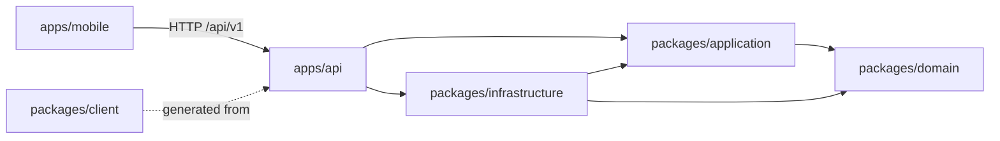

# Architecture

Cashdeck is a pnpm and Turborepo monorepo. The backend follows ports and
adapters (hexagonal architecture): business rules never import a database,
an HTTP client or a provider SDK. The Flutter app has its own architecture
guide in [apps/mobile/docs/architecture.md](../apps/mobile/docs/architecture.md).

## Packages



| Package                   | Holds                                                                                          | May depend on                 |
| ------------------------- | ---------------------------------------------------------------------------------------------- | ----------------------------- |
| `packages/domain`         | Entities, value objects and pure rules: money, tax ids, payment codes, the ladder, planning math | nothing (no npm, no Node I/O) |
| `packages/application`    | Use cases, ports (interfaces), DTOs validated with zod, and a fake for every port             | `domain`, `zod`               |
| `packages/infrastructure` | Prisma repositories, provider adapters, LLM providers, the secret vault, HTTP and mTLS transport | `domain`, `application`, npm  |
| `packages/client`         | Typed client generated from the OpenAPI document                                               | npm                           |
| `packages/i18n`           | pt-BR and en messages                                                                          | none                          |
| `packages/config`         | Shared tsconfig, eslint and vitest presets                                                     | none                          |
| `apps/api`                | Next.js route handlers, crons, webhooks and the composition root                               | everything above              |

`.dependency-cruiser.cjs` enforces these rules in `pnpm check`: the domain is
pure, the application reaches only the domain and zod, infrastructure never
imports an app, route handlers never import infrastructure directly, and no
module is part of a cycle.

## How a request flows

1. A route file under `apps/api/src/app/api/v1/<area>/route.ts` wraps its
   handler in `route(scope, handler)` from `apps/api/src/server/api/handler.ts`.
2. `route` checks that the server has a token, resolves the tenant,
   authenticates the device session and maps any thrown error to the error
   envelope (`apps/api/src/server/api/respond.ts`).
3. The handler validates the body with a zod schema exported by
   `@cashdeck/application` and calls a use case on the container.
4. The use case works through ports only. `apps/api/src/server/container.ts`
   (the composition root) decides which adapter backs each port.

```ts
export const PUT = route('household:set', async ({ request, tenantId, container }) => {
  const input = householdSchema.parse(await readJson(request))
  return ok(await container.household.set(tenantId, input))
})
```

## Ports and adapters

The ports live in `packages/application/src/ports`. The main ones:

| Port                                | Adapters in `packages/infrastructure`                                   |
| ----------------------------------- | ----------------------------------------------------------------------- |
| Repositories (accounts, bills, ...) | Prisma on Postgres; in-memory fakes                                     |
| `OpenFinanceProvider`               | `PluggyProvider` (one or two Pluggy accounts)                           |
| `PreviewProvider`                   | `PierreProvider`, an intraday feed between Pluggy collections           |
| `PaymentRail`                       | `AsaasRail`, `InterEmpresasRail`, `C6EmpresasRail`, the assisted step   |
| `ReserveFunder`                     | `ManualTopUpFunder` (the Asaas balance is topped up by hand)            |
| `BillSource`                        | `GmailBillSource`, `C6DdaBillSource`                                    |
| `PixLocationResolver`               | `JwsPixLocationResolver` for dynamic Pix codes                          |
| `InvoiceIssuer`                     | `NotaasIssuer`                                                          |
| `Notifier`                          | `FcmNotifier` (Firebase Cloud Messaging)                                |
| `LlmProvider`                       | Vercel AI Gateway, Gemini direct, a fake                                |
| `SecretVault`                       | `EnvelopeSecretVault` (AES-256-GCM, key from `CASHDECK_MASTER_KEY`)     |
| `Clock`, `IdGenerator`              | system clock and ids; fixed ones in tests                               |

Adapters are built by `createProviders` and read their credentials on every
call through `CredentialResolver`: a secret sealed in the database for one
entity, then for the whole tenant, then the environment variable. A missing
credential raises `ProviderNotConfiguredError`, which the payment ladder treats
as "move one step down". Details per provider are in
[providers.md](providers.md).

## Data

- Postgres through Prisma 7. The schema and migrations are in
  `packages/infrastructure/prisma`.
- Without `DATABASE_URL` the API runs on in-memory repositories with two sample
  entities, for local development only. A deployed server refuses to start
  without it, and production refuses to start without `CASHDECK_MASTER_KEY`.
- Every row carries `tenantId`. One deployment serves one household, with one
  personal entity (`PF`) and at most one company (`PJ`).
- Money is integer cents plus an ISO currency. Dates are São Paulo calendar
  days (`YYYY-MM-DD`); timestamps are UTC.

## Background work

Vercel crons in `apps/api/vercel.json` call `/api/cron/*` with
`Authorization: Bearer $CRON_SECRET`: Open Finance sync, the preview feed,
bill capture, the payment ladder, payment reconciliation, recurring invoices,
daily alerts, the monthly recap and vehicle prices. Provider webhooks under
`/api/webhooks/*` do the same work sooner when configured. The schedule is in
[deploy.md](deploy.md#vercel-project) and what each job does is in
[api.md](api.md#crons).

## Testing

- Unit tests use Vitest and never touch the network. Use cases run against
  the fakes in `packages/application/src/testing`; adapters run against
  scripted HTTP transports (`packages/infrastructure/src/testing`).
- Coverage gates: 100% on `domain` and `application`, 95% on the other
  packages and the API.
- Prisma repositories have an integration suite
  (`pnpm -C packages/infrastructure test:integration`) that needs
  `DATABASE_TEST_URL` or `DATABASE_URL` pointing at a disposable database.
- The mobile app has its own gate, `apps/mobile/tool/check.sh`.
